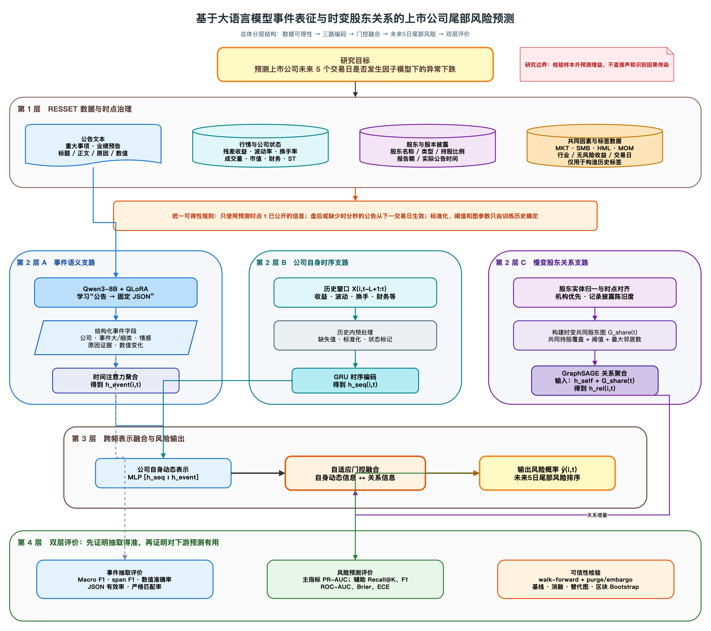

# llm-event-tail-risk

基于大语言模型事件表征与时变股东关系的上市公司尾部风险预测研究（硕士毕业论文）

## 研究概要

- **预测目标**：A股上市公司未来5个交易日是否发生因子模型下的尾部风险（异常下跌）
- **方法主线**：Qwen3-8B QLoRA 抽取业绩预告/重大事项事件语义 + 季度共同股东慢变图 + GRU时序编码 + 门控融合
- **评价**：双层评价（事件抽取质量 + 下游样本外预测增益）

## 目录结构

```
docs/
├── 开题方案/     研究整体方案（研究问题、数据设计、模型、实验）
├── 导师汇报/     选题汇报PPT、零基础讲解稿
└── 数据核查/     RESSET数据库字段核查报告、数据导出说明
图片/             论文总体分层结构图、实施流程图（drawio源文件 + PNG）
```

## 数据说明

原始数据（RESSET导出的xlsx，927MB）**不入库**：数据库有授权限制，且超GitHub单文件限额。数据本地存放在 `~/Desktop/RESSET论文数据/`，字段口径见 `docs/数据核查/`。

## 技术路线图


