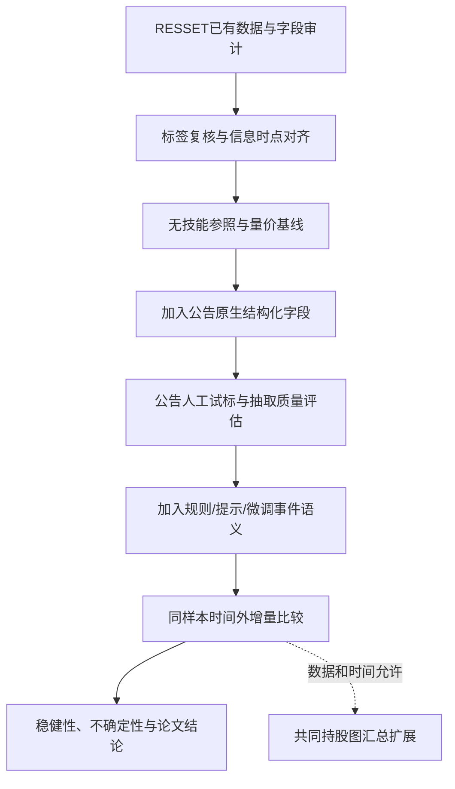

# 开题报告正文（工作初稿）

> 版本日期：2026-11-17。学校模板尚未收到，本文按常见开题报告结构起草，之后需要迁入学校模板。
>
> **建议题目（待导师确认）：基于公告事件表征的A股短期尾部风险预测研究。** 题目把技术焦点收在公告事件表征；共同机构持股先作为可选扩展，不作为主线按期完成的依赖。若导师要求保留关系网络，可将副标题或研究内容扩为“公告事件信息与共同持股关系的增量分析”。

## 一、研究背景与意义

股票市场中的极端下跌会给投资者、上市公司和金融监管带来较大的损失。传统风险指标常用历史波动、市场因子或负收益偏态描述风险，但投资者在交易日收盘前还会看到公司公告等新信息。业绩预告、诉讼仲裁等公告包含事件类型、方向、影响程度和原因描述，若能及时整理成结构化信息，就可以检验公告是否为短期风险识别提供了历史价格之外的补充信号。

本文拟研究：在每天收盘时点，只使用该时点已公开的信息，能否预测上市公司随后五个交易日的公司特有异常下跌风险；重点检验公告事件信息加入量价基线后，是否提高样本外识别能力。这里的“预测”指统计预测关系，不表示公告造成下跌，也不表示风险从一家公司的公告或股东关系因果传染到另一家公司。

研究的实践意义在于形成一种可复核的公司公告风险信息处理流程，并评估其在时间外样本中的实际预测增量。方法意义在于将公告理解任务与下游风险预测分开评价：先检查模型能否从公告中抽取可信事件，再检查这些事件在同一预测样本和时间切分下是否改善风险排序。即使增量不显著，也能据此界定公告文本对该预测任务的作用范围。

## 二、国内外研究现状

### （一）个股下行风险的定义与预测

金融研究使用多种方式刻画尾部风险，例如条件分位数、市场压力下的系统性风险贡献，以及由公司收益分布构造的股价崩盘风险指标。Engle 与 Manganelli（2004）提出 CAViaR，以条件分位数直接描述收益分布尾部；Adrian 与 Brunnermeier（2016）的 CoVaR 衡量金融机构处于压力状态时系统风险的条件变化。公司层面的崩盘风险研究则关注个股负向极端收益和公司信息环境的关系（Chen、Hong 与 Stein，2001；Hutton、Marcus 与 Tehranian，2009）。中国市场研究也使用 A 股样本考察公司行为与未来股价崩盘风险，例如江轩宇、许年行（2015）研究企业过度投资与未来股价崩盘风险的关系。该文的解释变量与本文不同，但说明公司特有崩盘风险已有中国市场实证基础。这些研究共同提示，风险定义必须与研究问题和观测频率相匹配。

本文不直接把市场整体大跌等同于单家公司风险，也不将经典年度崩盘风险指标直接搬到日频预测。本文暂以因子调整后的未来五日残差累计值，是否低于公司自身此前已完成窗口的历史第十百分位，构造公司日层面的二元标签。该标签是本研究的操作性定义，需与 P5 阈值、行业调整口径及历史阈值窗口替代方案进行稳健性比较。

### （二）财务文本与风险识别

财务文本研究表明，文本内容的风险含义依赖金融语境，通用词典可能把法律、会计等专业用语误判为负面情绪。Loughran 与 McDonald（2011）据此构建金融文本词典并检验财务文件中的词语分类。此后，预训练语言模型可用于文本分类、语义表示和信息抽取，但文本模型的识别质量不能替代下游预测检验。

中国市场已有将年报文本与股价暴跌风险联系起来的研究。例如，彭俞超、王南萱、顾雷雷（2023）基于 A 股年报文本，用依存句法识别企业数字化相关的预判性披露，并研究其与未来股价暴跌风险的关系。这说明不能把“文本信息用于中国上市公司崩盘风险研究”作为本课题的新颖性主张。该研究使用年度报告中的特定主题和年度崩盘风险设定；本文拟检验的差异是每日收盘时点下，公告事件信息对未来五个交易日因子调整尾部标签的预测增量。是否构成充分差异仍需检索和核对更多直接文献。

中文财经事件抽取方面，Chen 等（2024）的 EFSA 工作把事件表示为公司、行业、事件类别和情感等字段，并发布了基于财经新闻标注的数据集。其语料是新闻而非交易所公告，因此可参考其分层事件标注思路，不能直接将其抽取效果视为本研究公告上的效果。

本文关注交易所披露公告而非一般新闻，先以 RESSET 已有公告类型和数值字段建立可复核对照，再评估事件方向、类别、影响对象和文本证据等语义字段是否能由规则、提示模型或经人工标注数据微调的语言模型可靠抽取。是否进行 QLoRA 微调取决于试标一致性、独立测试集质量和时间条件；微调不是研究结论成立的前提。

### （三）机器学习与关系信息

Logistic 回归可作为结构清楚的线性分类器，梯度提升树适合检验表格变量中的非线性关系和交互。LightGBM（Ke 等，2017）因此适合作为本研究的主要表格预测器。两类模型应在相同公司日样本、特征可用时间和时间外切分下比较，并使用适合类别不平衡的平均精确率（Average Precision，AP）等指标。

公司关系网络提供另一类候选信息。GraphSAGE（Hamilton、Ying 与 Leskovec，2017）提出通过邻居采样和聚合学习节点表示的方法，适用于大规模图上的归纳表示学习。但本研究现阶段尚未完成按股东信息发布日期展开的时点图，也没有图覆盖率和图特征增量结果。因此，共同机构持股和图神经网络目前定位为后续扩展，不能在开题中写成已验证有效的核心方法。

### （四）现有研究与本研究的差距

已有工作已经把中国上市公司文本与未来崩盘风险相联系；同时也有中文财经新闻事件抽取研究。它们与本文在文本来源、风险标签频率和预测设定上存在差别，但不能仅凭这一点宣称本文填补了研究空白。本文可检验的研究问题收敛为：在预测时点和时间外评价严格一致时，公告事件语义相对于公司历史收益特征及公告原生结构化字段，是否带来稳定的短期尾部风险预测增量。

本研究不会把“尚无相关研究”作为前提，也不预设公告语义或图关系必然提升结果。提交开题前，将逐项补齐与 A 股公告风险预测最接近的中英文实证文献，并核实作者、年份、标题、数据、标签及结论；不保留无法核实的精确提升数字或绝对化新颖性表述。

## 三、研究目标、问题与假设

### 研究目标

建立一套可复现的公司日短期尾部风险预测实验，先得到量价基线，再以一致的样本外评估检验公告结构化字段和公告事件语义的增量价值，并分析结果对标签阈值、测试年份和样本构成的敏感性。

### 核心研究问题

在每天收盘时点可获得的信息下，公告事件表征能否在公司自身历史收益、波动和市场因子特征之上，提高未来五个交易日公司特有异常下跌风险的样本外识别能力？

### 待检验命题

- **H1（基线可预测性）：** 公司历史收益、波动和市场状态特征对本文定义的未来短期尾部标签具有高于无技能参照的样本外排序能力。
- **H2（公告字段增量）：** RESSET 原生公告类别和已有数值字段，在共同样本上相对于量价基线提供可测量的预测增量。
- **H3（语义增量）：** 通过人工核验的公告事件语义特征，相对于原生公告字段或简易规则特征，在时间外测试中提供额外增量。该命题可能不成立；若不成立，应如实报告。
- **H4（可选扩展）：** 若共同机构持股关系能够按公开日期无前视地构造，图汇总特征可能提供独立于公告与量价特征的预测信息。该项不作为主线按期完成的前提。

## 四、研究内容

1. **数据和标签核验。** 使用现有 RESSET 个股收益、日三因子、行业日收益、业绩预告、诉讼仲裁、股东名单及上市状态/行业变更数据。记录数据来源、字段、主键、缺失与覆盖期，复核标签计算和预测时点可用性。
2. **短期尾部标签与量价基线。** 对个股超额收益滚动估计三因子模型，冻结预测日系数，构造未来五个交易日残差累计值及公司历史分位数标签；比较无技能参照、Logistic 回归和 LightGBM。
3. **公告字段与文本事件表示。** 先加入公告原生类别、方向或数值字段，再建立简单规则/词典对照；人工标注公告样本，评估事件字段抽取的字段级准确性、精确率、召回率和 F1。若样本质量与时间允许，追加小型指令模型提示抽取或 QLoRA 微调比较。
4. **增量预测与解释。** 在完全相同的标签、时间折和共同样本上，比较量价基线、基线加原生公告字段、基线加文本事件特征；报告 AP、ROC-AUC、Recall@K 和 Brier 分数等指标，重点以 AP 评价不平衡标签下的正例排序。
5. **稳健性与可选关系扩展。** 改用 P5 阈值、行业调整标签、替代历史阈值窗口和不同测试期；检查重叠五日窗口对不确定性评估的影响。若股东时点图通过覆盖和时间审计，再加入少量共同持股汇总特征；GraphSAGE 只在前述结果和剩余时间允许时开展。

## 五、研究方法与技术路线

### （一）预测任务与标签

预测单位为公司—交易日。预测时点为交易日 (t) 收盘，仅使用 (t) 收盘前可获得的变量。利用截至 (t) 的最近 252 个有效个股收益观测，估计个股超额收益对日频三因子的线性回归；估计系数在预测未来窗口时保持固定。计算 (t+1) 至 (t+5) 五个连续市场交易日的残差累计值。若该累计值严格低于该公司此前已经结束的最近 252 个可用五日窗口结果的经验 P10（nearest-rank），记为正类；P5 为稳健性标签。未来五日存在收益缺失或不连续时不生成标签。

因变量的含义是“相对于公司自身近期历史分布较差的因子调整残差窗口”，不等同于破产、监管定义的重大风险或绝对损失概率。历史窗口高度重叠可能影响阈值稳定性和标准误，后续将通过替代阈值构造及按日期区块评估进行检验。

### （二）特征和信息时点

基线特征包括预测日之前可计算的个股历史收益、波动和市场/因子状态。公告若只有发布日期而无可靠时分秒，则从公告发布后的下一交易日起进入特征，避免把收盘后公开的信息当作收盘时已知。公告重复、更正和缺失正文按固定规则处理，并保留原生字段对照。尚未从现有数据确认的日市值、换手率及财务报表字段不作为主模型必需输入。

股东特征仅可使用已公开的股东信息。报告期截止日不能替代信息发布日期；如不能证明持股记录在预测时点已公开，则不用于该时点的模型特征。

### （三）预测模型与对照设计

先用正类发生率构造无技能参照，并训练 Logistic 回归和 LightGBM。首轮已归档试验报告四个测试期的平均 AP：无技能参照 0.1072、下行波动率 Logistic 0.1307、全特征 Logistic 0.2218、LightGBM 0.2366。首轮试验用于确认标签和流程可运行；它没有独立验证集，也没有按交易日区块置信区间，不作为最终模型优越性的结论。正式实验先冻结扩展窗训练/验证/测试日期及至少五个交易日的 purge，再只在验证期选择参数，锁定测试期后进行一次时间外比较。

模型比较按信息块逐步进行：

| 编号 | 特征块 | 目的 |
|---|---|---|
| M0 | 正类发生率/无技能排序 | 判断模型是否优于基本参照 |
| M1 | 个股历史收益、波动、市场因子 | 量价基线 |
| M2 | M1 + RESSET 原生公告字段 | 检验结构化公告信息增量 |
| M3 | M2 + 人工核验的公告事件语义 | 检验文本语义增量 |
| M4（可选） | M3 + 时点共同持股汇总 | 探索关系信息增量 |

主要指标为 AP；补充 ROC-AUC、Recall@Top 10%、正类 F1 和 Brier 分数。比较时报告共同样本数、正类率和测试期。模型差值的不确定性按交易日区块计算，避免将同日大量公司观测误当作相互独立；另对相邻标签窗口重叠做敏感性分析。

### （四）公告事件抽取评估

第一阶段使用约 300 条样本试标，双人复核子样本，报告标签定义分歧并修订标注规范。只有当试标显示事件字段可稳定判定后，才扩大标注集。事件抽取模型与人工金标准比较，按字段报告精确率、召回率、F1 和错误类型；训练、验证、测试按时间及重复事件分组，防止近重复文本泄漏。结构化事件汇总到公司—交易日时，按公告可用日期滞后生效。LLM 的输出不得直接当作金标准。

### 技术路线

## 六、数据基础与可行性

目前已有的标签面板包含 6,116,554 个公司日，日期范围为 2017-02-06 至 2024-07-24，P10 标签正类率为 10.94%。标签审计确认当前面板无重复公司日、无无效标签行，P10/P5 与对应阈值比较一致。首轮基线已对 2021、2022、2023 和 2024 年前七个月进行时间外预测。

公告方面，已有业绩预告和诉讼仲裁资料，合计约 18.3 万条；业绩预告为主要文本语料，诉讼仲裁作为辅助信息。已有约 404 万条股东名单记录，但时点图尚未构造。已有个股收益和因子数据足以支撑当前定义的标签与首轮基线；未确认的换手率、市值、财务数据不纳入主线，因此现阶段无需为开题新增下载。

实施可行性主要来自：第一，标签、字段审计、基线代码和首轮结果已有本地记录；第二，公告原生结构化字段可先形成不依赖微调的低成本对照；第三，公告 LLM 与股东图均有可降级路线，主研究不依赖未完成的 GPU 训练或 GNN。当前主要风险是公告人工标注未完成、研究现状引文待核实、最终训练验证测试协议尚未冻结，以及股东信息时点图未实现。

## 七、可能的创新与预期成果

本研究将“创新”限定为本论文具体应用和可验证设计，不预先声称首创：

1. **研究对象与预测标签：** 构造日频公司自身历史分位数下的因子调整五日尾部事件标签，并在预测时点冻结估计量与可用信息。
2. **公告信息的双层检验：** 将公告事件抽取质量与下游样本外预测增量分别评价，区分“抽取得像”与“对风险预测有用”。
3. **严格的增量比较：** 采用同样本、时间顺序切分和 purge 比较量价、结构化公告与文本语义特征，并对结果差异进行区块不确定性评估。

预期成果为：可复核的标签和预测数据处理代码；公告事件人工标注与抽取评估记录；量价、公告原生字段及文本语义的样本外比较结果；对标签与模型局限的讨论。若文本模型没有稳定增量，结论将明确报告该结果，不把“预期有效”替代实证发现。

## 八、进度安排

| 时间 | 工作内容 | 阶段成果 |
|---|---|---|
| 11月17日—11月22日 | 按导师反馈收敛题目；补核核心文献；整理数据、标签和基线事实；完成学校模板版初稿 | 开题报告可审阅初稿、文献核验表 |
| 11月23日—11月27日 | 按导师意见修改，核对格式、研究范围、方法和进度 | 11月27日前提交开题报告及汇报材料 |
| 11月28日—12月13日 | 固化数据与标签重建说明，冻结正式时间切分和评价方案 | 数据流程、标签方案、比较协议 v1 |
| 12月14日—1月10日 | 完成公告试标、规则/提示抽取评价及公告日对齐；条件允许时训练小模型 | 金标准试标、公告特征表及抽取评估 |
| 1月11日—1月31日 | 完成公告增量预测、稳健性分析；有余力时开展共同持股特征扩展 | 主结果表、消融和稳健性记录 |
| 2月1日—2月7日 | 撰写全文并核对数字与代码输出 | 2月7日前完成论文完整初稿 |
| 2月8日—2月28日 | 根据反馈修改，复核关键结果、格式与答辩材料 | 2月28日前完成报告终稿和答辩材料 |

## 九、参考文献（已知书目信息；提交前仍需按学校格式核对）

1. Adrian, T., Brunnermeier, M. K. CoVaR. *American Economic Review*, 2016, 106(7): 1705–1741. DOI: 10.1257/aer.20120555.
2. Chen, J., Hong, H., Stein, J. C. Forecasting crashes: Trading volume, past returns, and conditional skewness in stock prices. *Journal of Financial Economics*, 2001, 61(3): 345–381. DOI: 10.1016/S0304-405X(01)00066-6.
3. Engle, R. F., Manganelli, S. CAViaR: Conditional autoregressive value at risk by regression quantiles. *Journal of Business & Economic Statistics*, 2004, 22(4): 367–381. DOI: 10.1198/073500104000000370.
4. Hamilton, W. L., Ying, R., Leskovec, J. Inductive Representation Learning on Large Graphs. *Advances in Neural Information Processing Systems*, 2017, 30.
5. Hutton, A. P., Marcus, A. J., Tehranian, H. Opaque financial reports, R², and crash risk. *Journal of Financial Economics*, 2009, 94(1): 67–86. DOI: 10.1016/j.jfineco.2008.10.003.
6. Ke, G., Meng, Q., Finley, T., et al. LightGBM: A Highly Efficient Gradient Boosting Decision Tree. *Advances in Neural Information Processing Systems*, 2017, 30.
7. Loughran, T., McDonald, B. When Is a Liability Not a Liability? Textual Analysis, Dictionaries, and 10-Ks. *The Journal of Finance*, 2011, 66(1): 35–65. DOI: 10.1111/j.1540-6261.2010.01625.x.
8. 江轩宇，许年行. 企业过度投资与股价崩盘风险[J]. *金融研究*, 2015(8): 141–158. [期刊条目检索入口](http://www.cqvip.com/Main/Detail.aspx?id=666043863)。正式引用前需取得并核对期刊原文。
9. Chen, T., Zhang, Y., Yu, G., Zhang, D., Zeng, L., Ao, X. EFSA: Towards Event-Level Financial Sentiment Analysis. In: *Proceedings of the 62nd Annual Meeting of the Association for Computational Linguistics*, 2024. [作者单位对论文与数据集的介绍](https://iip.ict.ac.cn/xwdt/kydt/202406/t20240613_228299.html)。正式引用前补齐 ACL Anthology 页码及稳定链接。
10. 彭俞超，王南萱，顾雷雷. 企业数字化转型、预判性信息披露与股价暴跌风险[J]. *财贸经济*, 2023(5). [中央财经大学研究介绍](https://sf.cufe.edu.cn/info/1157/12762.htm)。页码及完整刊期信息待按原文核对。

> **开题提交前核验项：** 补充中国 A 股公告文本、公司特有尾部风险预测及中文金融事件抽取的直接相关实证文献；通过原文确认每篇文章的样本、任务、方法和结论，再决定是否纳入研究现状。第 8–10 项已有检索入口但仍需核对原文及最终出版信息。现有参考文献不支持“尚无研究”或创新性优先权判断。

## 十、开题前待确认事项

- 最终题目与技术焦点是否按“公告事件表征”为主。
- 学校开题模板、字数、引用格式和汇报时长。
- 导师是否要求共同持股/图神经网络作为必做内容；当前计划将其作为通过时点图审计后的扩展。
- 正式训练、验证、测试年份及 purge 规则。首轮基线的年份不应自动视为正式最终协议。
