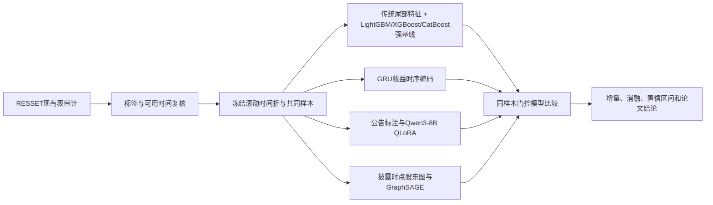

# 硕士学位论文开题报告正文

## 论文题目

**披露时点感知的A股短期尾部风险预测**

> 说明：本稿按常见开题报告结构编写，尚未套入学校模板。文中的题目和全部技术模块组成一套固定研究设计。导师要求的格式、封面项目、篇幅和参考文献样式，应在取得学院模板后调整。报告不将未完成的训练写成既有结果，也不预先承诺性能提升。

## 一、研究背景和意义

### （一）研究背景

个股价格的极端下跌通常不是普通日常波动的简单延长。它可能集中反映公司经营变化、法律纠纷、信息披露、融资情况以及市场整体环境。传统股价崩盘研究主要从较长时期的收益分布和公司治理、信息环境等角度解释崩盘风险；实际的风险监测则需要在信息陆续公开时及时更新判断。上市公司公告提供了公司层面的新增信息，机构持股关系呈现了公司之间较为稳定的联系，而过去收益和市场因子则刻画了近期价格状态。三类信息在内容、频率和可用时间方面并不相同，将其放入同一个预测任务，需要明确它们何时能够使用以及信息失效或陈旧时如何处理。

本课题围绕一个范围明确的预测问题展开：在交易日 (t) 收盘时，只使用截至该时点已经公开的信息，预测该公司在随后五个市场交易日是否出现相对于自身近期历史分布异常偏低的因子调整收益。模型结合公司日收益序列、上市公司公告事件和共同机构持股网络。Qwen文本抽取以业绩预告为语料；诉讼仲裁记录按公告日期和类型形成事件计数及最近事件年龄。公告从发布时间决定生效日；持股边依据数据库中的信息发布日期更新；图关系超过一定时间后不被简单视作新信息，而由披露年龄描述其陈旧程度。模型利用可用性感知门控，学习公告、关系图和收益序列在不同信息状态下的权重。

本研究的“预测”仅指样本外统计预测，不识别公告对收益的因果效应，也不检验一家公司的风险因果性地传染给另一家公司。尾部风险标签是研究中的操作定义，不等于破产、行政监管定义的风险或绝对损失概率。

### （二）研究意义

理论与方法意义在于把日频价格序列、稀疏公告事件和低频持股关系放入统一的时间外预测框架，并将信息可用状态及图信息的新旧程度显式输入融合门控。这样可以检验两件不同的事：文本模型是否能够抽取公告事件，以及抽取结果是否真的改善风险排序。若只评价文本分类准确率，不能说明文本对下游金融预测有用；若只比较融合模型的最终分数，也难以判断增量来自公告、图还是网络容量。

实践意义在于建立一套可追溯的数据时点处理与样本外风险评估流程。输出不是买卖信号，而是可供进一步风险筛查研究使用的公司日风险排序方法。通过报告前10%风险名单的召回与精确率，可以呈现有限审核容量下模型捕获尾部样本的能力。

## 二、国内外研究现状与评述

### （一）股价崩盘与尾部风险预测

Chen、Hong 与 Stein（2001）从交易量、过去收益及条件偏度研究股价崩盘预测；Hutton、Marcus 与 Tehranian（2009）讨论财务报告不透明性与崩盘风险。相关研究提供了公司层面崩盘风险的理论和经验基础，但通常采用年度收益特征、年度崩盘指标和解释性面板分析。本研究采用交易日为预测单位，以未来五日公司特有因子残差的历史分位数构造标签，并关注时间外预测能力。因此，其结果属于不同频率、不同操作定义下的预测实验，不应与经典年度回归的系数或分类分数直接比较。

### （二）公告文本和风险识别

财务文本的含义依赖具体业务语境。Loughran 与 McDonald（2011）指出，通用词典会误判法律、会计类词语在财务文件中的情绪含义。预训练语言模型和事件抽取方法可以把原始文本转成类别、方向和证据片段，但抽取效果必须在目标语料上通过人工标注检验。

中国上市公司文本与崩盘风险已有研究。彭俞超、王南萱、顾雷雷（2023）基于2012—2019年A股年报文本，使用依存句法分析区分数字化信息中的预判性内容和行动性内容，并研究其与未来股价暴跌风险的关系。这一研究说明不能把“文本用于A股崩盘风险研究”作为本课题的首创主张。两者关注的文本来源和任务不同：前者围绕年报中的数字化主题及未来崩盘风险；本课题以业绩预告、诉讼仲裁公告为事件来源，检验事件语义对短期尾部标签的样本外增量。

Chen 等（2024）的 EFSA 工作研究中文财经新闻的事件级金融情感分析，可为事件字段定义和分层标注提供参考。新闻文本和上市公司正式公告的表达习惯、标签空间和可用时点不同，不能把 EFSA 报告的抽取指标直接当作本地公告模型的准确率。研究中将由人工金标评价本地事件抽取器，再将预测时点以前已公开的事件映射到公司日特征。

### （三）机构持股关系与图学习

Hou 与 Liu（2023）直接研究机构交叉持股与股价崩盘风险，是本课题持股关系方向的直接相关先例。因而本文不把“共同机构持股会连接公司”或“机构关系和崩盘风险相关”作为新发现。本文拟处理的问题是如何把持股数据中实际的公开日期保留下来，构造预测日可见的公司—机构异构图，并在日频风险预测中与公告、收益序列联合学习。正式提交前需阅读全文核实该研究的具体样本、变量、标签和识别策略，避免仅凭标题作详细比较。

图神经网络方面，Hamilton、Ying 与 Leskovec（2017）的 GraphSAGE 通过采样和邻居聚合学习节点表示；Cheng 等（2022）提出用于金融时间序列预测的多模态图神经网络；Feng 等（2019）的 Temporal Relational Ranking 研究时变股票关系下的预测排序。这些文献说明图学习和金融关系预测已有基础，本课题不把 GraphSAGE 或“使用关系图”本身称为创新。需要通过消融确认持股图是否为现有价格序列和公告以外带来有效信息，并检验简单拼接是否已经足够。

### （四）研究述评与本课题定位

已有研究分别涉及A股文本—崩盘风险、机构网络—崩盘风险、中文财经事件抽取和金融关系图预测。更近的工作使本设计的相似性风险更明确：Jing 等（2024）直接研究中国股票崩盘风险并使用 Graph WaveNet；Zong 等（2025）的 MSGCA 已经使用金融指标序列、动态文档、关系图和门控交叉注意力；Yi 等（2026）进一步研究金融 LLM、多关系图和股票趋势动态融合。此外，中国发明专利 CN117808586A《基于多关系重构与融合图神经网络的股价崩盘风险预测方法》（2024-04-02 公开）从公开摘要看，已将时间序列、关系重构、多关系融合图神经网络用于上市公司股价崩盘风险预测，与本课题的“风险目标＋时序＋关系图”重合明显。专利全文和权利要求尚未核验。现有方案与 MSGCA 的模型框架高度接近，与专利及其他近期工作也有方向重叠，因此不能声称“三路融合、图网络、LLM”本身构成原创。

本研究目前的可检验定位为：在公司日频、未来五交易日公司特有因子残差 P10 标签下，按真实公开时点构造公告与共同机构持股图；检验模态可用状态和持股边年龄能否在 MSGCA 式普通门控以及强表格/图时序基线之上提供增量。由于 CN117808586A 已覆盖股价崩盘风险、时间序列和多关系图神经网络的组合，当前方案的方向区分度存在实质风险；现阶段不能说已确认不重复。专利权利要求、CNKI、万方学位论文库和校内学位论文库尚未完成检索，必须在开题定稿前核验并由导师判断定位是否足以区分近邻。本文不预设组合模型必然优于任一基线；若导师要求明显算法原创，应先重新定义核心研究问题或方法。

## 三、研究目标、问题与假设

### （一）研究目标

建立一套使用现有 RESSET 数据的上市公司日频尾部风险预测原型，完成标签核验、公告事件抽取、时点共同持股图构造、多源模型训练和严格时间外评价。重点评估披露时点/信息年龄条件融合相对于传统风险特征、强表格模型、Graph WaveNet、专利启发式多关系时序GNN与 MSGCA 式三模态门控的 AP 增量，并报告增量的不确定性。

### （二）核心研究问题

1. 公司历史收益与市场因子能否对本文定义的未来五日尾部标签提供稳定的时间外排序能力？
2. 公告事件语义和时点共同机构持股图是否分别提供超出量价序列的样本外信息？
3. 在相同三路输入下，将公告可用性和持股边年龄输入门控后，是否比 MSGCA 式普通门控交叉注意力及简单拼接表现更稳定？

### （三）待检验假设

- **H1：** 公司日收益序列的 GRU 表示在时间外样本中优于相同收益输入的表格基线。
- **H2：** 模型预测的公告事件语义在公司收益序列基础上带来额外预测信息；人工金标只用于抽取评价。
- **H3：** 根据公开时点构造的机构持股图在收益和公告信息之外带来额外预测信息。
- **H4：** 在相同三路输入下，模态可用状态与持股边年龄条件融合，相较 MSGCA 式普通门控交叉注意力，获得更稳定的 AP 与 Top10% 风险名单表现。

假设允许被否定。若完整模型没有稳定增益，仍按预注册式比较协议报告结果，分析错误来源和适用边界，不将不显著结果写成提升。

## 四、研究内容

1. **数据审计与时点表构建。** 对个股日收益、因子、公告、股东和历史行业/上市状态文件记录字段、覆盖期、主键、缺失、重复和映射规则。原始文件只读，授权数据和公告原文不提交公开仓库。
2. **未来尾部标签及序列特征。** 使用预测日以前252个有效收益观测拟合三因子模型，冻结系数计算未来五日残差累计值，以此前已经结束的252个可用五日窗口的公司自身P10作为阈值。构造60交易日GRU序列及现有收益、波动、因子特征。
3. **公告事件抽取。** 以业绩预告为Qwen训练语料，通过人工标注方向、文本明确陈述的原因和原文证据。训练Qwen3-8B QLoRA抽取器，另设按时间和重复事件隔离的测试集；诉讼仲裁记录构造公司日事件计数、类型和最近发生年龄，不与业绩方向标签混为一类。
4. **披露时点共同机构图。** 用股东信息发布日期更新机构—公司二部图；GraphSAGE聚合一跳机构和两跳公司关系。报告图覆盖率、节点边数、披露年龄、主体匹配和错误率。
5. **可用性感知多模态门控模型。** 将GRU、事件表示和GraphSAGE表示投影到同一向量维度，把公告是否出现、有效边是否存在、最近持股披露年龄等状态送入门控，融合后预测尾部标签。
6. **基线、消融与稳健性。** 比较传统尾部特征 Logistic、LightGBM/XGBoost/CatBoost、GRU、Graph WaveNet、专利启发式多关系时序GNN、MSGCA式三模态交叉门控、单公告/单图增强、简单拼接、固定融合和本研究时点/边龄条件融合。检查P5标签、行业调整、边打乱、移除新鲜度特征及不同图覆盖分组。

## 五、研究方法与技术路线

### （一）标签与预测时点

预测样本为公司—交易日。令 (r_{i,s}) 为公司收益，(r_{f,s}) 为无风险收益，(F_s=(Rmrf_s,SMB_s,HML_s)) 为流通市值加权三因子。在交易日 (t) 对每家公司以最近252个有效观测估计：

\[
r_{i,s}-r_{f,s}=\alpha_{i,t}+\beta_{i,t}^{\top}F_s+\epsilon_{i,s},\quad s\le t.
\]

系数在构造未来标签时冻结。未来五交易日累计残差为：

\[
CAR^{(5)}_{i,t}=\sum_{k=1}^{5}\left(r_{i,t+k}-r_{f,t+k}-\hat\alpha_{i,t}-\hat\beta_{i,t}^{\top}F_{t+k}\right).
\]

若 (CAR^{(5)}_{i,t}) 低于 (t) 时点前已结束的最近252个有效五日窗口分布的 第26次序统计量（固定252个窗口下的P10；P5取第13项），则 `label_p10=1`，否则为0。P5是稳健性标签。窗口中缺少收益或非连续交易日时剔除该标签。阈值不能用全样本未来窗口回算。标签有重叠，训练/验证/测试边界至少 purge 五个市场交易日，标准误和置信区间采用交易日分块方法。

### （二）数据和样本范围

已核数据覆盖：个股日收益约909.2万条，2015-01-05至2024-07-31；日三因子至2025-12-31；行业收益至2025-12-31；业绩预告约16.2万条；诉讼仲裁约2.1万条；主要股东约403.7万条；行业及上市状态变更约7,364条。已生成标签面板6,116,554个公司日，范围2017-02-06至2024-07-24，P10正类率10.94%。首轮基线有效标签测试行数为3,372,287个公司日。

现有数据未确认含全时期可用的日市值、换手率、成交额及带信息发布日期的财务报表，故这些变量不作为模型必要特征。所有模型采用相同标签和共同样本；比较图模型时另报告图可用子样本结果和相对于全量共同样本的变化，避免因筛选造成表面提升。

### （三）模型结构

**收益时序支路：** 取预测日前60个交易日的个股收益、超额收益及三因子变量，加入仅用历史构造的累计收益、波动率和有效率指标。单层64维GRU编码日序列，输出128维向量。

**公告语义支路：** 对约1,500条业绩预告人工标注，其中至少20%由两位标注者重复标注。为避免抽取器训练文本晚于首个风险测试期，按时间和事件ID固定划分为2017–2019训练、2020验证、2021–2024-07独立测试；实际集合数量按样本分布报告，不随机重分年份。Qwen3-8B使用4-bit QLoRA抽取固定JSON：预期经营/财务方向、文本明确的原因短语和支持判断的原文证据。原生业绩预测类型和数值区间直接保留，防止LLM猜测数值。用微调Qwen的公告正文池化表示和模型预测事件槽位形成事件编码；按公司日聚合最近60个交易日的预告并用时间注意力汇总。诉讼仲裁另产生公司日/滚动事件计数、事件类型和最近事件年龄。

**股东关系支路：** 只在股东数据的 `InfoPubDt` 已公开之后建立或更新图边；报告截止日期不能提前作为边生效时间。机构实体优先依赖GDID，缺失ID仅在“类型+规范化名称+跨期核验”后匹配。图边记录持股比例、披露年龄和报告期字段；剔除个人股东和可确认的重复口径。两层GraphSAGE在公司—机构—公司结构上进行邻居采样聚合，生成128维公司关系表示。邻居未来风险标签、未来收益和未来披露均不作为节点特征。

**披露年龄约束的残差融合。**

收益序列是每日更新的主干，公告和持股是异步更新的辅助信息。普通门控只能从数据中学习年龄的影响，不能保证缺失分支不干扰主干，也不能限制陈旧信息的修正幅度。本研究把约束直接写入风险分数。

记三路向量为 s、e、g，各为128维。序列风险分数为 z_s=w_sᵀs+b_s；公告与图的修正值分别为 δ_e=tanh(w_eᵀe+b_e)、δ_g=tanh(w_gᵀg+b_g)。δ限制在[-1,1]，约束的是logit修正，不是收益幅度。

对辅助分支 m∈{e,g}，定义：
a_m = M_m · Q_m · exp[-softplus(λ_m)·A_m] · sigmoid(G_m([s;h_m;M_m;A_m;Q_m]))；
z = z_s + a_eδ_e + a_gδ_g，p = sigmoid(z)。

M表示是否存在有效信息。公告Q为严格JSON合规且证据可追溯的质量标记或有效事件比例；它不使用真实未来标签，也不把模型自报的置信度当成可靠概率。图Q在主实验取1，主体映射不可靠的边预先排除。公告年龄按60交易日归一化，图年龄按252交易日归一化。G为单层线性门，输入维度259，输出标量；编码器和门一起训练。

这个设计有两个可直接检查的性质。两辅助分支均缺失时，z严格等于z_s，避免空向量和softmax分配改变已有序列预测。每个分支满足 |a_mδ_m|≤M_mQ_m exp[-softplus(λ_m)A_m]，因此陈旧度增加时允许的最大修正幅度单调缩小。门本身仍可随内容变化，不能把这个上界性质写成“预测概率对年龄严格单调”。年龄缩放单位和三个衰减参数随配置固定记录。

事件层采用带年龄衰减的注意力：先将冻结Qwen正文池化表示和预测结构字段投影至128维，再计算非负注意力乘有效掩码、质量与exp(-λA)，归一化后加权求和；所有事件缺失时返回零向量。最近60交易日的业绩预告最多保留8条，超出按生效时间倒序截取。诉讼仲裁单独形成最近5/20/60日计数、类别和最新年龄，进入序列风险头的结构控制项与相同信息表格对照；不得用业绩预告掩码屏蔽诉讼事实。

图消息显式使用边权，而不是把边字段写进说明后调用不支持它们的普通SAGE。公司到机构权重 v_ij=max(share_ij,0)exp[-softplus(λ_edge)age_ij/252]。机构向量为邻接公司序列向量的加权均值，经线性变换和tanh；机构到公司再次按同一边权聚合，并与该公司序列向量拼接投影至128维。实现称为年龄加权的二部GraphSAGE式聚合。主图使用持股比例的统一总股本口径，不混合总股本与流通股口径；两类口径另做稳健性检验。无邻居公司返回零图表示。

训练损失为未加权BCE(z,y)+0.2BCE(z_s,y)+0.1BCE(z_e,y|M_e=1)+0.1BCE(z_g,y|M_g=1)。辅助损失保证分支不是仅靠融合门获得梯度；无辅助信息时对应损失为零。所有损失只计算当前训练日期的目标公司，不监督采样邻居的未来标签。使用AdamW，初始学习率10^-3、weight_decay=10^-4；候选学习率{3×10^-4,10^-3}，最大20轮，验证AP连续3轮不改善早停，梯度范数上限1。概率校准只在验证集拟合温度/截距并检查Brier；未校准输出称风险分数，校准不接触测试标签。

**训练与推断。**

Qwen3-8B先完成事件抽取训练，随后冻结。对每条去重事件只编码一次：使用非思考模板，将公告正文作为输入，取最后一层正文token隐藏状态的掩码均值，排除系统提示、公司名称包装、padding和生成JSON。原始向量以float16缓存，再由训练期拟合的投影降至128维。缓存键包括原文哈希、抽取器权重哈希、模板版本及截断策略；时间聚合在风险训练时在线计算。测试公司日使用模型预测字段，不读取人工金标。

金融大模型预训练时间晚于2017—2024回测期间。因此这里测量的是现代抽取器用于历史资料的回顾性效用，不能声称当年已经能部署Qwen3。采用公司名/证券代码匿名化、只用结构化原生字段的控制，并检查去掉文本隐藏表示后的结果；这些控制减少记忆风险，但不能证明预训练绝无污染。

GRU与图消息网络共同训练，不把随机初始化的GRU/GraphSAGE表示当作冻结缓存。可以缓存历史原始序列、有效掩码、事件向量和图边索引；每天的公司与机构隐表示必须按当前权重重新计算。批次为同一市场交易日目标公司及采样邻居，每层最多采样15/10个邻居。采样可用于训练，但正式推断优先分块全邻居加权聚合，记录其与采样预测的差异。

单日推断步骤为：读取截至t的60日原始序列与缺失掩码；读取已经生效的公告缓存；重建t之前最后一份完整Top10股东披露；用当前GRU得到目标与邻居公司向量；执行二部年龄加权消息；计算质量、可用状态与年龄；生成z_s和两路有界修正；输出风险分数并记录各分支修正。模型不会看到未来五日收益，它们仅在离线评价时用于标签。

工程原型位于 project/scripts/research_model.py，时间规则位于 point_in_time.py，评价位于 evaluate_predictions.py。原型接口明确了一日多公司的输入张量、有效掩码和边字段，适合继续接入本地RESSET面板。它与完成全量训练是不同交付阶段，结果表只填写实际训练得到的数字。

### （四）实验设计和评价指标

扩展窗口按年份滚动：训练/验证/测试分别是2017—2019/2020/2021、2017—2020/2021/2022、2017—2021/2022/2023、2017—2022/2023/2024年1月至7月。所有边界至少purge五交易日。只在验证年份选参，测试年份不能用于筛选特征和参数。

同任务对照包含：测试折正类率/随机排序；60日下行波动 Logistic；滚动残差偏度、DUVOL、残差波动和最大回撤等传统尾部统计的 Logistic；LightGBM、XGBoost、CatBoost 强表格模型组；GRU；改造版 Graph WaveNet；在核验 CN117808586A 全文后实现的专利启发式多关系时序 GNN 对照；MSGCA 式三模态门控交叉注意力；以及单公告、单图、原生公告字段、简单拼接、普通门控和本研究时点/边龄门控。若只能根据摘要实现，则明确标为“摘要启发式适配”，不冒称复现专利。超参数只由验证年选择；每折验证期确定的最强比较模型作为主参照。

公告抽取器独立比较规则/RESSET原生字段、Qwen3-8B零样本或少样本、Qwen3-8B QLoRA；抽取指标与下游风险 AP 分开报告。所有预测模型共享同一测试公司日和时间折，缺失模态通过掩码表达，并对公告/图共同覆盖子样本补充结果。

主指标为 Average Precision（AP），辅助指标为 ROC-AUC、Recall@Top10%、Precision@Top10%、正类 F1、Brier 分数和概率校准。主增量是本研究模型相对“验证期选出的最强比较模型”的同一测试行配对 ΔAP，报告绝对值、相对增幅、年度差值和 20 个交易日区块 bootstrap 区间，并补充 5 日、60 日区块敏感性。AP 不是准确率，异论文报告的 AUC/AP 不能作为同数据同任务的直接对照。

### （五）实施流程

## 六、同方向论文比较与创新点

| 方向 | 已有代表研究 | 与本研究的重合 | 本研究的边界与实证对照 |
|---|---|---|---|
| 中国股价崩盘风险图模型 | Jing 等（2024），改造版 Graph WaveNet | 直接涉及中国股票崩盘风险和图时序建模 | 使用同一五日尾部标签重新训练图时序模型，不照搬跨样本的原论文分数 |
| 中国股价崩盘风险多关系图专利 | CN117808586A（2024），时间序列＋显/隐关系重构＋多关系融合 GNN | 与本课题“风险预测＋时序＋关系图”高度重合；公开摘要尚未显示公告事件或披露年龄机制，专利全文/权利要求待核 | 获取全文及权利要求，逐项比对关系、标签、频率和时点处理；在核验完成前不声称该方法方向不重复 |
| 三模态股票预测和门控 | Zong 等（2025），MSGCA | 指标序列、动态文本、关系图和门控交叉注意力与本方案高度相似 | 把 MSGCA 式融合作为核心比较模型；通用三模态门控不称为本研究原创 |
| 金融 LLM 与动态多关系 | Yi 等（2026），Financial LLM-enhanced multi-relational dynamic fusion | LLM、价格/文本、多关系和动态融合方向接近 | 获取全文和代码后核对具体模块；将不可复现部分明确列为比较局限 |
| 机构持股网络与崩盘风险 | Hou & Liu（2023）；Investor Network Density（2025） | 机构关系与崩盘风险已经研究 | 重点检验按真实公开时点构图后对未来五日排序是否有增量 |
| 文本与崩盘风险 | 彭俞超等（2023）；Banks’ Crash Text（2025） | 年报/讲话文本已进入崩盘风险预测 | 本研究是公司公告的事件级抽取，另比较 RESSET 原生字段和 Qwen3-8B 输出 |
| 财经事件抽取 | Chen 等（2024，EFSA） | 事件字段和财经文本抽取 | 在业绩预告人工金标上重新测抽取质量，新闻语料指标不直接套用 |

### 可检验贡献与边界

1. 用公司自身未来五日的因子残差累计值相对历史 P10 定义短期尾部事件，明确区分年度崩盘代理指标和普通涨跌方向任务。
2. 依据公告发布日期和股东信息发布日期重建预测日信息集，禁止把报告期截止日当作公开时点；显式表示模态是否可用，并将披露年龄写入辅助修正上界与边级消息。
3. 在同一测试公司日比较传统风险特征、强表格模型、Graph WaveNet、专利启发式多关系时序GNN、MSGCA 式门控架构和本研究的披露时点/年龄条件机制，测量事件、关系和融合设计的逐步增量。

门控融合、GraphSAGE、LLM 信息抽取和股票关系建模都已有研究。公开检索尚未命中与本研究全部频率、标签和披露处理细节都相同的单篇论文，但中国专利 CN117808586A 已覆盖股价崩盘风险、时间序列和多关系图神经网络的组合；MSGCA 已覆盖序列、文本、关系图和门控融合。因此当前方向有显著近邻，尚未确认其区别足以满足导师的原创性要求。专利全文/权利要求、中文数据库和校内学位论文查重待完成；在完成前，创新定位只能写成待检验的应用性贡献，不宣称首创或已确认不重复。完整检索边界见[《同方向文献核验与题目论证》](同方向文献核验与题目论证.md)。

## 七、可行性、风险与处理

### （一）可行性

现有收益和因子数据已经形成完整标签面板及首轮基线，因此项目可从可运行的量价模型起步。公告文本和股东持股记录已经存在，无需把补齐财报、日市值或换手率作为开题前置条件。模型实现拆成序列、抽取、图和融合四个相对独立模块，深度训练与大表处理可分开进行。Qwen3-8B 4-bit QLoRA需要另行租用GPU，优先租用24GB及以上显存并使用梯度检查点；股东图和主预测器使用小批稀疏邻居采样。当前本地首轮LightGBM等结果为流程参照，不能替代正式实验。

### （二）风险与处理

1. **LLM标签一致性有限。** 先完成200条试标，按类别、方向和证据字段检查分歧；在规范冻结后扩大标注集；重复标注至少20%，报告一致性与字段级F1。
2. **共同机构名称映射错误。** GDID优先；缺失ID建立可审核映射，不盲目模糊匹配；抽样人工核对并报告排除比例和图覆盖率。
3. **低频持股信息陈旧。** 边龄作为输入，评估不同边龄分组的风险排序；不能把季报期末日期误当作公开日。
4. **标签重叠和市场分布变化。** 测试边界purge，按交易日分块bootstrap，逐年报告正类率、AP和增量。
5. **模型可能不提升。** 将AP增量与区块置信区间作为结论；若无显著增量，讨论数据质量、覆盖度、标签噪声、关系稀疏和市场漂移，不变更指标追求正结果。
6. **训练资源和样本规模。** Qwen3-8B采用4-bit QLoRA；建议租用24GB或以上显存并启用梯度检查点。图使用按日快照与稀疏采样；训练参数、耗时、显存、种子及checkpoint写入实验记录。原始授权数据和公告全文不入Git。

## 八、研究计划

| 阶段 | 分类与工作 | 验收物 |
|---|---|---|
| 11/23—11/27 | 开题：修订算法、近邻核验、设计报告、正文和PPT；通过原型功能检查 | 固定方案、文献边界、开题可审稿、测试记录 |
| 11/28—12/06 | 数据：重跑来源/版本字段，检查完整披露组与实体；同步200条人工试标 | 时点报告、股东覆盖/抽查、标注裁决 |
| 12/07—12/13 | 数据：冻结四折及purge；完成1500条主标和300条双标 | 样本索引、金标分布、一致性指标 |
| 12/14—12/20 | 基线：仅收益与同信息表格组、GRU；Qwen零样本与QLoRA | 正式基线、抽取质量、日志及版本 |
| 12/21—12/27 | 模型：冻结事件缓存、日图输入与诉讼控制；Graph WaveNet与多关系适配 | 数据批次、适配说明、功能与小规模训练结果 |
| 12/28—01/03 | 模型：MSGCA式对照、完整有界残差模型，验证年选参 | 锁定超参、显存/吞吐和训练报告 |
| 01/04—01/17 | 实验：四折五种子主比较；同信息公平性和每日预测审计 | 逐折结果、全部种子、逐样本预测 |
| 01/18—01/31 | 实验：固定消融、P5、匿名文本、图随机化、块CI | ΔAP/CI、误差与覆盖分层 |
| 02/01—02/07 | 写作：完成正文和真实表格，核准引用与创新表述 | 论文完整初稿与数字来源表 |
| 02/08—02/21 | 修改：导师反馈、关键结果复核、格式与答辩PPT | 送审稿、复现说明、答辩稿 |
| 02/22—02/28 | 归档：终稿、演练、非敏感代码配置与实验汇总 | 最终交付与可追溯归档 |

标注与图版本核验前移，避免把全部训练挤在1月最后一周。取得全文/权利要求的阻碍需如实记录；这些问题不通过编造细节或省略强对照解决。资源排期以200条抽取和单日图训练测量为依据，未测量前不承诺训练时长。

## 九、预期成果

1. 一套可复现的公司日尾部风险标签、60交易日序列和披露时点多源特征流程。
2. 一份人工标注规范及公告事件抽取独立测试评估记录。
3. 按真实披露时间构造的公司—机构图数据及覆盖/陈旧度审计报告。
4. 传统尾部特征 Logistic、LightGBM、XGBoost、CatBoost、GRU、Graph WaveNet、专利启发式多关系时序GNN、MSGCA式三模态融合和本研究时点/边龄感知模型的同样本比较结果。
5. 完整论文、主实验配置、模型评估结果、数据字典和不含授权原始数据的代码仓库。

预期成果不包含预先承诺的固定 AP 增幅。模型是否提高以及提升幅度由锁定的样本外实验决定。

## 十、主要参考文献

1. Chen, J., Hong, H., & Stein, J. C. Forecasting crashes: Trading volume, past returns, and conditional skewness in stock prices. *Journal of Financial Economics*, 2001, 61(3): 345–381. DOI: [10.1016/S0304-405X(01)00066-6](https://doi.org/10.1016/S0304-405X(01)00066-6).
2. Hutton, A. P., Marcus, A. J., & Tehranian, H. Opaque financial reports, R², and crash risk. *Journal of Financial Economics*, 2009, 94(1): 67–86. DOI: [10.1016/j.jfineco.2008.10.003](https://doi.org/10.1016/j.jfineco.2008.10.003).
3. Loughran, T., & McDonald, B. When Is a Liability Not a Liability? Textual Analysis, Dictionaries, and 10-Ks. *The Journal of Finance*, 2011, 66(1): 35–65. DOI: [10.1111/j.1540-6261.2010.01625.x](https://doi.org/10.1111/j.1540-6261.2010.01625.x).
4. Hamilton, W. L., Ying, R., & Leskovec, J. Inductive Representation Learning on Large Graphs. *Advances in Neural Information Processing Systems*, 2017, 30.
5. Ke, G., Meng, Q., Finley, T., et al. LightGBM: A Highly Efficient Gradient Boosting Decision Tree. *Advances in Neural Information Processing Systems*, 2017, 30.
6. Hu, E. J., Shen, Y., Wallis, P., et al. LoRA: Low-Rank Adaptation of Large Language Models. *International Conference on Learning Representations*, 2022.
7. Dettmers, T., Pagnoni, A., Holtzman, A., & Zettlemoyer, L. QLoRA: Efficient Finetuning of Quantized LLMs. *Advances in Neural Information Processing Systems*, 2023, 36.
8. Feng, F., He, X., Wang, X., Luo, C., Liu, Y., & Chua, T.-S. Temporal Relational Ranking for Stock Prediction. *ACM Transactions on Information Systems*, 2019, 37(2): 1–30. DOI: [10.1145/3309547](https://doi.org/10.1145/3309547).
9. Cheng, D., Yang, F., Xiang, S., & Liu, J. Financial time series forecasting with multi-modality graph neural network. *Pattern Recognition*, 2022, 121: 108218. DOI: [10.1016/j.patcog.2021.108218](https://doi.org/10.1016/j.patcog.2021.108218).
10. Hou, C., & Liu, H. Institutional cross-ownership and stock price crash risk. *Research in International Business and Finance*, 2023, 65: 101906. DOI: [10.1016/j.ribaf.2023.101906](https://doi.org/10.1016/j.ribaf.2023.101906).
11. Chen, T., Zhang, Y., Yu, G., et al. EFSA: Towards Event-Level Financial Sentiment Analysis. In: *Proceedings of the 62nd Annual Meeting of the Association for Computational Linguistics*, 2024: 7455–7467. DOI: [10.18653/v1/2024.acl-long.402](https://doi.org/10.18653/v1/2024.acl-long.402).
12. 彭俞超，王南萱，顾雷雷. 企业数字化转型、预判性信息披露与股价暴跌风险[J].《财贸经济》，2023(5)。作者单位介绍及内容摘要：[中央财经大学金融学院](https://sf.cufe.edu.cn/info/1157/12762.htm)。页码和学校引用格式提交前按原文复核。

13. Jing, Z., Li, Q., Zhao, H., & Zhao, Y. Predicting Stock Price Crash Risk in China: A Modified Graph WaveNet Model. *Finance Research Letters*, 2024. DOI: [10.1016/j.frl.2024.105468](https://doi.org/10.1016/j.frl.2024.105468).
14. Zong, C., Wan, J., Cascone, L., & Zhou, H. Stock Movement Prediction with Multimodal Stable Fusion via Gated Cross-Attention Mechanism. *Complex & Intelligent Systems*, 2025, 11. DOI: [10.1007/s40747-025-02023-3](https://doi.org/10.1007/s40747-025-02023-3).
15. Yi, S., Xu, M., Qin, X., Shen, Q., Zhang, C., & Chi, J. Financial LLM-enhanced multi-relational dynamic fusion for stock trend prediction. *World Wide Web*, 2026. DOI: [10.1007/s11280-026-01444-5](https://doi.org/10.1007/s11280-026-01444-5).
16. Investor Network Density and Stock Crash Risk. *Economic Papers*, 2025. DOI: [10.1111/ecpo.12348](https://doi.org/10.1111/ecpo.12348).
17. Banks’ Stock Price Crash Risk Prediction with Textual Analysis: A Machine Learning Approach. *Annals of Operations Research*, 2025. DOI: [10.1007/s10479-025-06567-y](https://doi.org/10.1007/s10479-025-06567-y).
18. Stock Price Crash Warning in the Chinese Security Market Using a Machine Learning-Based Method and Financial Indicators. *Systems*, 2022, 10(4), 108. DOI: [10.3390/systems10040108](https://doi.org/10.3390/systems10040108).
19. 中国发明专利 CN117808586A（2024-04-02 公开），《基于多关系重构与融合图神经网络的股价崩盘风险预测方法》，申请号 CN202311809825.3。[万方专利记录](http://d.wanfangdata.com.cn/patent/ZL_CN202311809825.3_CN117808586A_20240402)。现阶段仅核对公开摘要，专利全文与权利要求待核。

> **文献核对说明：** 参考文献条目、相近工作和检索边界见[《同方向文献核验与题目论证》](同方向文献核验与题目论证.md)。本稿中与论文机制、结果相关的细节应在提交前逐篇阅读全文核对，不能仅凭标题或搜索摘要写成确定结论。

## 附：原型实现、正式比较和验收细则

### 可复现的数据契约与逐项验收

原始数据由脚本读取，保持只读；加工数据、事件正文、逐样本预测和模型权重写在仓库之外。市场日历来自DRET实际市场日期，而非公司自己的有效收益日期。序列固定60个市场交易日，停牌或缺失收益用0占位并附掩码，因子是否有效也要独立标记。回归训练观测必须同时满足收益、无风险收益和三个因子均有限；预测日自身缺失收益时保留该公司日，但序列明确表达缺失状态。未来五日缺任一观测则不生成标签。

公司日索引字段为stock_code、date、outcome_end、label_p10、label_p5、fold、split。统一样本以标签有效性和主体映射定义，公告或图缺失不删除公司。原始11项特征的20日累计收益缺失数为81,581，20,759对应5日累计收益，不能互换。标准化均值/方差、异常截断边界及缺失填充值只从训练期估计，再原样用于验证和测试。

公告去重除正文哈希外，需要公司、公告类别、预测对象、报告期、原始事件ID和修订关系；同一事件家族以首次披露确定家族时间。跨时间边界的后续修订仍按实际生效时间保留在风险面板，但不能同时充当抽取训练集和独立测试金标。事件家族冲突样本移出独立抽取测试并记录原因。标注200条试标只来自2017—2019；1500条主样本和300条双标都由人工完成，目前CSV仅为模板，不能称已有金标。

股东图必须先验证完整披露组。组键由公司、报告期、发布日期、来源、SHSer/名单类别和更新版本组成；缺组内排名、来源或版本证据时标记为“无法确认完整”，不凭凑够10行推定完整。新完整披露替换整份旧名单，消失机构表示不再进入公开Top10，并不表示实际清仓。较旧报告期的补录不覆盖更新报告期。InfoSource、SHSer、UpDt字段在加工中保留，原始列名以实际导出头为准。历史版本是否被数据库事后改写，需要逐组核验；发布日期本身不能证明点时真实性。

实体优先用GDID；个人、托管名义持有人与无法可靠识别的机构不进入主图。基金产品与基金管理人分别建键，不自行合并；香港中央结算等名义持有人单列覆盖与排除敏感性。不能把所有非自然人都解释为共同机构投资行为。名称映射表、样本抽查记录和每年图覆盖率必须随实验版本保存。

训练数据契约：一批一日，seq[N,60,F]及同形掩码；events[N,8,128]、event_mask/age/quality[N,8]；edges[2,E]为公司—机构整数ID，edge_share/age[E]；graph_age[N]；label[N]及supervised[N]区分目标与邻居。每个日期附可用时间最大值与生成配置哈希，自动断言max_available_date≤date。结构诉讼控制另存[N,C]并由风险头和表格基线共享。正式训练前先通过日期边界、完整名单替换、缺失模式和梯度测试。

### 正式实验登记表与失败判定

首先在每个训练折构造相同信息强表格模型：收益尾部统计、原生公告字段、模型预测事件方向/原因计数、诉讼统计、图度数/加权持股集中度和披露年龄。与仅收益表格模型同时报告，分别衡量信息增量和网络结构增量。新增文本和关系信息不能只给主模型而不给强表格对照。树模型每类最多8组超参、相同验证年与相同计算预算，记录选择过程。

架构对照统一使用同一GRU、同一事件缓存和同一图输入，差异限定于拼接、普通门控、MSGCA式两阶段交叉门控和本研究有界残差融合。MSGCA原论文已有“以完整指标指导稀疏文档和图融合”，所以收益主干本身不是创新。本文区别在实际披露年龄对应的显式修正上界、缺失回退约束，以及边级衰减。Graph WaveNet与专利启发式多关系模型作为任务适配；没有全文细节时，不写成原论文复现，也不将未完成模型列入已跑结果。

核心消融固定为：M完整；M去事件；M去图；M去年龄（注意力、边消息和残差上界同时关闭）；M去质量；仅把年龄作为普通预测特征；去辅助损失；图边仅去衰减；随机重连图；仅原生事件字段；仅Qwen预测结构字段；匿名文本。每项消融说明对应假设，改变数据来源和改变融合机制分开比较。

主指标先计算逐折AP，再对四折取等权平均；全期 pooled AP附报，不能混作同一数字。主对照按该折验证AP选定最强同信息模型，测试不重新选择。主模型5个种子报告全部结果与均值，不挑最佳种子。ΔAP的置信区间用相同日期块配对重采样，同一天全部公司一起抽取；20日为主、5和60日为敏感性。bootstrap估计样本时序不确定性，种子标准差估计训练不确定性，两者分别列出。

Top10%定义为每个交易日风险排名前ceil(0.1N_t)家公司，证券代码固定破除分数并列；报告每日精确率及有正例日期的每日召回率平均。旧基线按全年公司日取前10%的指标仅保留为先导历史记录，不当作每日预警结果。正类阈值由验证集选，测试F1不搜索阈值。

最终表格固定列为模型、输入信息、测试年、样本量、正类率、AP、ΔAP、95%CI、ROC-AUC、每日Top10精确率/召回率、Brier、训练时长与峰值显存。真实提升例：现有先导LightGBM相对11特征Logit的AP差0.014795，即约1.48个百分点、相对6.67%；这是已有表格基线之间的差，不是新设计提升。完整模型对应单元格保持“待训练”，不填预计精度。

若正式实验置信区间跨0，贡献表述改为“刻画披露年龄、抽取误差与预测稳定性的关系”，完整报告未稳定提高的条件。算法、同信息基线和数据审计仍构成可答辩的研究工作，但不能声称假设已成立。

### 资源与交付规格

数据准备和标签复核在CPU完成；图按日期和公司分块，不一次性加载600万样本的全部60日序列。Qwen3-8B用4bit NF4、LoRA rank16、alpha32、dropout0.05、最大正文长度1024token、batch1与梯度累计16启动。24GB GPU作为起始配置，是否容纳取决于正文长度和隐藏状态缓存方式，先用200条测峰值显存与吞吐再排租赁时长。风险网络128维、GRU64，单日批次按显存调整；不承诺未测量的训练小时数。

提交物为本研究设计报告、开题正文、可再生成PPT、任务树/周计划、数据处理与模型原型、正式协议、测试与交接。最终论文还需真实人工金标、GPU训练、同信息基线、四折五种子评估及消融，这些工作不能被文档生成代替。论文图表由冻结预测生成，数字引用保留来源文件和git版本，用户可从任何表格追到实际实验。

